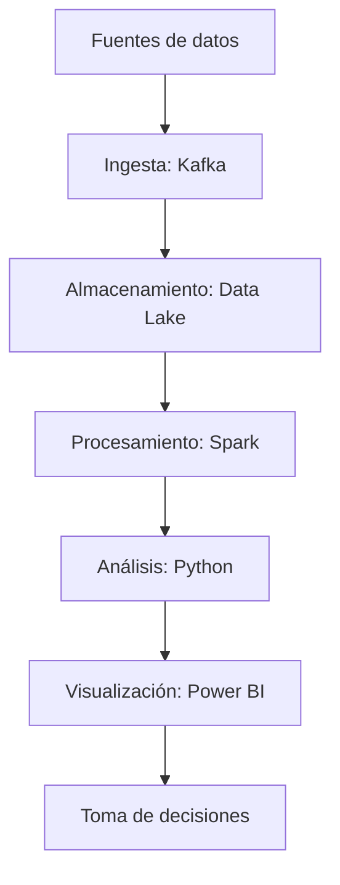
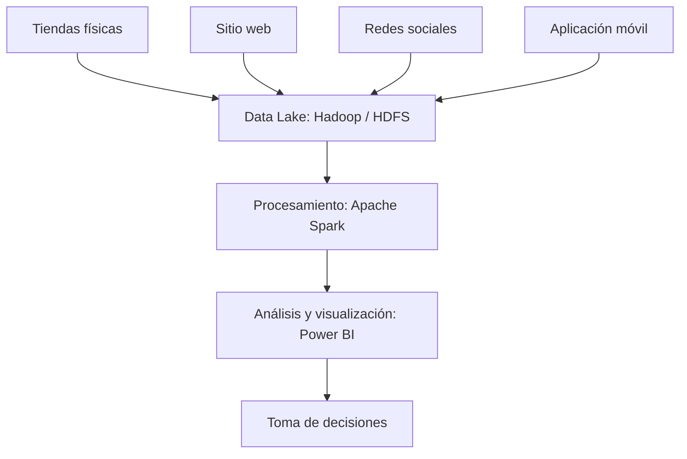

# Herramientas Big Data

## Sesión 11

**Temas:** Repaso del ecosistema Big Data, repositorios de almacenamiento, casos de uso en la industria y práctica con un caso de estudio.

---

## Contenido

1. Repaso de Big Data.
2. Repositorios de almacenamiento.
3. Casos de uso en banca, retail y telefonía.
4. Práctica: caso de estudio RetailMax.

# 1. Repaso de Big Data

## ¿Qué es Big Data?

Big Data es el conjunto de tecnologías y técnicas que permiten almacenar, procesar y analizar volúmenes masivos de datos que no pueden manejarse eficientemente mediante métodos tradicionales.

## ¿Por qué surge Big Data?

Las bases de datos tradicionales comenzaron a presentar limitaciones debido al crecimiento acelerado de la información:

- Lentitud en el procesamiento.
- Altos costos de almacenamiento.
- Dificultad para analizar datos no estructurados.
- Problemas para obtener información en tiempo real.

## Las 5 V de Big Data

- **Volumen:** cantidad de datos que se generan y recopilan en diferentes fuentes.
- **Velocidad:** rapidez con la que los datos se generan, transmiten y procesan.
- **Variedad:** diversidad de tipos y formatos de datos, estructurados y no estructurados.
- **Veracidad:** confiabilidad, calidad y consistencia de los datos.
- **Valor:** utilidad que se obtiene al convertir los datos en información para tomar decisiones.

## Ecosistema de Big Data

El ecosistema de Big Data comprende las siguientes etapas:

1. **Fuente de datos:** genera la información.
2. **Ingesta:** captura y transporta los datos.
3. **Almacenamiento:** guarda grandes volúmenes de datos.
4. **Procesamiento:** limpia y transforma los datos.
5. **Análisis:** encuentra patrones y conocimiento.
6. **Visualización:** presenta resultados mediante gráficos y tableros.
7. **Toma de decisiones:** utiliza la información para mejorar procesos y estrategias.

### Herramientas utilizadas en el ecosistema

| Etapa | Función | Herramientas de ejemplo |
|---|---|---|
| Ingesta | Captura y transporte de datos desde múltiples fuentes | Kafka, NiFi |
| Almacenamiento | Guarda grandes volúmenes de datos | HDFS, MongoDB |
| Procesamiento | Limpieza, transformación y procesamiento de datos | Spark, Hadoop |
| Análisis | Descubrimiento de patrones y generación de conocimiento | Python, TensorFlow |
| Visualización | Presentación de resultados para apoyar decisiones | Power BI, Tableau |

## Beneficios de Big Data para las empresas

- Mejor toma de decisiones.
- Predicción de tendencias y demanda.
- Optimización de inventarios.
- Automatización de procesos.
- Integración de información de múltiples fuentes.
- Mayor competitividad.
- Análisis en tiempo real.

## Retos de Big Data

- Calidad de los datos.
- Seguridad y privacidad.
- Integración de distintas fuentes.
- Costos de infraestructura.
- Falta de talento especializado.
- Gobierno de datos.

## Actividad: cadena de supermercados

Una cadena nacional de supermercados desea analizar la información que generan:

- Compras en línea y en tiendas físicas.
- Comentarios en redes sociales.
- Uso de su aplicación móvil.
- Sensores de temperatura en refrigeradores.
- Programa de clientes frecuentes.

La empresa quiere conocer los hábitos de compra de sus clientes para mejorar promociones y aumentar ventas.

### Instrucciones

1. **Identificar las fuentes de datos.** Indica cuáles son las fuentes del caso y clasifícalas como estructuradas, semiestructuradas o no estructuradas.
2. **Relacionar el caso con las 5 V de Big Data.** Explica cómo se presentan el volumen, la velocidad, la variedad, la veracidad y el valor.
3. **Diseñar una arquitectura Big Data sencilla.** Identifica qué herramientas se utilizarían en cada etapa.

### Solución propuesta

**1. Fuentes de datos**

| Fuente | Tipo de dato |
|---|---|
| Compras en tiendas | Estructurado |
| Comentarios en redes sociales | No estructurado |
| Sensores IoT | Semiestructurado |

**2. Relación con las 5 V**

- **Volumen:** miles de transacciones diarias.
- **Velocidad:** los sensores envían información continuamente.
- **Variedad:** datos de ventas, redes sociales y sensores.
- **Veracidad:** se requiere validar datos duplicados o incorrectos.
- **Valor:** permiten generar promociones personalizadas.

**3. Arquitectura propuesta**

# 2. Repositorios de almacenamiento

## ¿Qué es un repositorio de almacenamiento?

Es una plataforma diseñada para almacenar, organizar y gestionar información proveniente de diferentes fuentes. Según el tipo de datos y el uso que se les dará, una organización puede implementar arquitecturas como Data Warehouse, Data Lake o Data Lakehouse.

> En particular, un Data Warehouse almacena datos previamente procesados, limpios y estructurados, y está optimizado para consultas complejas, reportes empresariales e inteligencia de negocio (BI).

## Data Warehouse

Un **Data Warehouse (almacén de datos)** es un repositorio central diseñado para almacenar datos estructurados provenientes de diferentes sistemas de una organización. Su objetivo principal es facilitar la generación de reportes, dashboards y análisis de negocio.

### Características

- Datos organizados en tablas y relaciones.
- Información limpia y procesada.
- Alto rendimiento para consultas analíticas.
- Utilizado por directivos y analistas de negocio.

### Relación con arquitecturas modernas

Un Data Warehouse puede alimentarse desde un Data Lake o un Lakehouse, aprovechando los datos almacenados y procesados para generar reportes, dashboards e indicadores de negocio.

## Data Lake

Un **Data Lake** es un repositorio centralizado que permite almacenar grandes volúmenes de datos en su formato nativo o en bruto, ya sean estructurados, semiestructurados o no estructurados, sin necesidad de procesarlos o definirlos previamente.

### Beneficios de un Data Lake

1. **Recopilación e ingesta flexibles:** recibe información de múltiples fuentes, como sistemas, archivos, dispositivos IoT y redes sociales, mediante cargas por lotes o en tiempo real.
2. **Optimización de costos y recursos:** almacena datos en bruto utilizando infraestructura en la nube y herramientas de código abierto, lo que puede reducir costos y mejorar el aprovechamiento de recursos.
3. **Escalabilidad y rendimiento:** utiliza recursos de almacenamiento y cómputo escalables para gestionar grandes volúmenes de datos y soportar análisis avanzados, inteligencia artificial y aprendizaje automático.
4. **Toma de decisiones más rápida y colaborativa:** integra el acceso a información de toda la organización y facilita la colaboración entre analistas, científicos de datos y áreas de negocio.

### Diferencias entre Data Lake y Data Warehouse

| Data Lake | Data Warehouse |
|---|---|
| Guarda datos en bruto. | Guarda datos procesados. |
| Admite datos estructurados y no estructurados. | Trabaja principalmente con datos estructurados. |
| Es más flexible en cuanto a formatos. | Tiene una organización y estructura definidas. |
| Se utiliza, entre otros fines, para Big Data e IA. | Se utiliza para reportes y BI. |

**Idea clave:** un Data Lake centraliza información de múltiples fuentes en un único repositorio y conserva los datos en su formato original. Esto ayuda a reducir los silos de información y facilita el acceso para su análisis posterior. Un Data Lake unifica el acceso a los datos, no necesariamente los datos en sí.

## Data Lakehouse

Un **Data Lakehouse** es una solución de gestión de datos que combina el almacenamiento flexible y de bajo costo de un Data Lake con capacidades de análisis de alto rendimiento similares a las de un Data Warehouse.

Al igual que un Data Lake, puede almacenar datos estructurados, semiestructurados y no estructurados. Sobre ese almacenamiento incorpora una capa de gestión que agrega estructura y gobierno de datos para apoyar cargas de trabajo analíticas e inteligencia de negocio.

### Beneficios de un Lakehouse

- Unificación del acceso a los datos.
- Analítica de alto rendimiento.
- Inteligencia de negocios y ciencia de datos en un mismo entorno.
- Reducción de costos.
- Gobierno y calidad de datos.

## Evolución de las arquitecturas de datos

Un Data Lakehouse no necesariamente reemplaza al Data Lake ni al Data Warehouse. Combina fortalezas de ambos para ofrecer almacenamiento masivo, escalabilidad, gobierno de datos y rendimiento analítico en una misma plataforma.

# 3. Casos de uso en la industria: banca, retail y telefonía

## Banca

Los repositorios de Big Data permiten centralizar información de clientes, transacciones, canales digitales y cajeros automáticos.

**Casos de uso:**

- Detección de fraude en tiempo real.
- Análisis de riesgo crediticio.
- Segmentación de clientes.
- Ofertas personalizadas de productos financieros.
- Cumplimiento regulatorio y auditorías.

**Ejemplo:** un banco puede analizar millones de transacciones diarias para identificar operaciones sospechosas y prevenir fraudes antes de que ocurran.

## Retail

Los datos provienen de puntos de venta, compras en línea, programas de lealtad y redes sociales.

**Casos de uso:**

- Predicción de demanda.
- Gestión inteligente de inventarios.
- Recomendación de productos.
- Análisis del comportamiento de compra.
- Personalización de promociones.

**Ejemplo:** una cadena comercial puede anticipar qué productos tendrán mayor demanda en determinadas fechas y ajustar su inventario oportunamente.

## Telefonía

Las compañías generan grandes volúmenes de datos a partir de llamadas, navegación, antenas y aplicaciones móviles.

**Casos de uso:**

- Optimización de la red.
- Monitoreo del desempeño de antenas.
- Prevención del abandono de clientes (churn).
- Detección de anomalías y fraudes.
- Ofertas personalizadas de servicios.

**Ejemplo:** un operador telefónico puede identificar zonas con alta congestión de tráfico para ampliar su infraestructura y mejorar la experiencia del usuario.

## Conclusión de los casos de uso

Los repositorios de Big Data permiten transformar grandes volúmenes de información en conocimiento útil para optimizar operaciones, mejorar la experiencia del cliente y apoyar la toma de decisiones estratégicas.

## Pregunta de reflexión

Si el INEGI quisiera analizar datos de encuestas, censos, aplicaciones web, imágenes satelitales y registros administrativos, ¿utilizaría un Data Warehouse, un Data Lake o un Lakehouse? ¿Por qué?

# 4. Práctica: caso de estudio RetailMax

## Contexto

Actualmente las empresas generan enormes cantidades de información a través de ventas, redes sociales, aplicaciones móviles, sensores y sitios web. El reto ya no es obtener datos, sino convertirlos en conocimiento útil para tomar mejores decisiones.

La empresa **RetailMax** cuenta con 150 tiendas distribuidas en todo el país y una plataforma de comercio electrónico.

Durante los últimos meses ha detectado:

- Disminución de ventas en algunas regiones.
- Incremento del abandono de carritos de compra.
- Menor frecuencia de compra de clientes registrados.
- Comentarios negativos en redes sociales.
- Incremento de la competencia digital.

La dirección solicita un análisis utilizando conceptos de Big Data para identificar causas y proponer soluciones.

## Datos disponibles

### Fuente 1. Ventas en tienda

| Fecha | Tienda | Producto | Categoría | Cantidad |
|---|---|---|---|---:|
| 01/10/2026 | Norte | Laptop | Tecnología | 10 |
| 01/10/2026 | Centro | Celular | Tecnología | 18 |
| 01/10/2026 | Sur | Pantalla | Tecnología | 7 |

### Fuente 2. Sitio web

| Usuario | Tiempo en sitio | Productos vistos | Compra |
|---|---:|---:|---|
| U001 | 20 min | 25 | Sí |
| U002 | 3 min | 4 | No |
| U003 | 15 min | 18 | Sí |

### Fuente 3. Redes sociales

Comentarios:

- “Excelente servicio y entrega rápida.”
- “Los precios son más altos que la competencia.”
- “Me gustaría más promociones.”
- “La aplicación móvil falla constantemente.”

## Actividad 1. Identificación de las 5 V de Big Data

Completa la relación entre cada característica y un ejemplo de RetailMax.

| Característica | Ejemplo en RetailMax |
|---|---|
| Volumen | |
| Velocidad | |
| Variedad | |
| Veracidad | |
| Valor | |

### Preguntas

- ¿Qué datos generan más volumen?
- ¿Cuál información se produce en tiempo real?
- ¿Qué datos son estructurados y cuáles no estructurados?

### Solución de la actividad 1

| Característica | Ejemplo en RetailMax |
|---|---|
| **Volumen** | Miles de transacciones de ventas, registros de clientes, historiales de compra y navegación en el sitio web generados diariamente. |
| **Velocidad** | Compras en línea, consultas al sitio web, actividad en la aplicación móvil y comentarios en redes sociales que se generan en tiempo real. |
| **Variedad** | Datos estructurados (ventas, clientes e inventarios) y no estructurados (comentarios en redes sociales, reseñas, imágenes y mensajes de clientes). |
| **Veracidad** | Necesidad de validar datos incorrectos, duplicados o falsos, como perfiles duplicados, errores de captura o comentarios fraudulentos. |
| **Valor** | Identificar tendencias de compra, mejorar promociones, reducir el abandono del carrito y aumentar la satisfacción del cliente. |

**1. ¿Qué datos generan más volumen?**

- Registros de ventas de las 150 sucursales.
- Transacciones del comercio electrónico.
- Historial de compras de clientes.
- Datos de navegación del sitio web, como clics, búsquedas y productos vistos.
- Información generada por la aplicación móvil.

**Conclusión:** el mayor volumen proviene de las ventas y de la actividad digital de los clientes.

**2. ¿Cuál información se produce en tiempo real?**

- Compras en línea.
- Navegación en el sitio web.
- Consultas y búsquedas de productos.
- Uso de la aplicación móvil.
- Comentarios y publicaciones en redes sociales.
- Actualización de inventarios después de cada venta.

**Conclusión:** la información que cambia continuamente y requiere procesamiento rápido corresponde a la dimensión de velocidad.

**3. ¿Qué datos son estructurados y cuáles no estructurados?**

- **Estructurados:** datos almacenados en tablas con campos definidos, como ventas, inventarios y registros de clientes.
- **No estructurados:** datos que no siguen un formato fijo, como comentarios, reseñas, imágenes y mensajes publicados en redes sociales.

## Actividad 2. Ecosistema Big Data

Selecciona una tecnología adecuada para cada actividad.

| Actividad | Herramienta |
|---|---|
| Almacenar grandes volúmenes de datos | |
| Procesamiento distribuido | |
| Dashboard y visualización | |
| Bases de datos NoSQL | |
| Procesamiento en tiempo real | |

**Opciones:** Hadoop, Spark, MongoDB, Power BI y Kafka.

**Pregunta:** ¿Por qué eligieron cada herramienta?

### Solución de la actividad 2

| Actividad | Herramienta | Justificación |
|---|---|---|
| Almacenar grandes volúmenes de datos | **Hadoop** | Distribuye el almacenamiento entre varios servidores mediante HDFS. En RetailMax puede conservar ventas históricas, visitas al sitio, inventarios y comentarios. Permite escalar agregando servidores. |
| Procesamiento distribuido | **Spark** | Procesa grandes volúmenes de datos en paralelo. Puede analizar transacciones, identificar patrones de compra, calcular recomendaciones y detectar productos más vendidos por región. |
| Dashboard y visualización | **Power BI** | Convierte los datos procesados en gráficos, indicadores y reportes interactivos para monitorear ventas, tendencias, abandono de carritos y campañas. |
| Bases de datos NoSQL | **MongoDB** | Almacena información flexible en documentos, adecuada para comentarios, historiales de navegación, perfiles de consumidores y datos de dispositivos móviles. |
| Procesamiento en tiempo real | **Kafka** | Captura y transmite información para su procesamiento inmediato, como compras en línea, eventos de la aplicación, inventarios e interacciones en el sitio web. |

## Actividad 3. Repositorio de almacenamiento

La empresa necesita centralizar toda la información.

**Diseña una arquitectura sencilla identificando:**

- Fuentes de datos.
- Repositorio Big Data.
- Herramienta de procesamiento.
- Herramienta de análisis.

**Pregunta:** ¿Qué ventajas tendría un Data Lake sobre una base de datos tradicional?

### Solución propuesta

1. **Fuentes de datos:**
   - Tiendas físicas: ventas, inventario y clientes.
   - Sitio web: navegación, compras y carritos.
   - Redes sociales: comentarios y opiniones.
   - Aplicación móvil: consultas y compras.
2. **Repositorio Big Data:** Data Lake, por ejemplo, con Hadoop/HDFS.
3. **Herramienta de procesamiento:** Apache Spark.
4. **Herramienta de análisis y visualización:** Power BI.

**Ventajas de un Data Lake frente a una base de datos tradicional:**

- Puede almacenar datos estructurados, semiestructurados y no estructurados.
- Conserva los datos en su formato original.
- Permite centralizar información de distintas fuentes.
- Facilita el análisis posterior con diferentes herramientas.
- Puede escalar para atender el crecimiento de los datos.

## Actividad 4. Análisis del negocio

Con la siguiente información, determina posibles hallazgos.

### Ventas por categoría

| Categoría | Ventas |
|---|---:|
| Tecnología | $500,000 |
| Hogar | $300,000 |
| Deportes | $100,000 |
| Moda | $250,000 |

### Abandono de carrito

| Mes | Porcentaje |
|---|---:|
| Enero | 15% |
| Febrero | 18% |
| Marzo | 22% |
| Abril | 27% |

### Opiniones de clientes

- Aplicación lenta.
- Pocas promociones.
- Excelente atención.
- Buenos productos.
- Precios elevados.

### Preguntas

1. ¿Qué tendencia observan?
2. ¿Cuál es el principal problema?
3. ¿Qué datos son relevantes para la toma de decisiones?
4. ¿Qué información adicional solicitarían?

### Solución y hallazgos

**1. ¿Qué tendencia observan?**

Existe una tendencia creciente en el abandono de carrito. En cuatro meses pasó de **15% a 27%**, un incremento de **12 puntos porcentuales**. Cada vez más clientes agregan productos al carrito, pero no finalizan la compra.

**2. ¿Cuál es el principal problema?**

El principal problema identificado es el incremento en el abandono de carrito, que podría estar relacionado con comentarios de los clientes sobre:

- Aplicación lenta.
- Precios elevados.
- Pocas promociones.

Estos factores pueden provocar que los usuarios abandonen la compra antes de finalizar el pago. Se requiere analizar más información para confirmar las causas.

**3. ¿Qué datos son relevantes para la toma de decisiones?**

- **Ventas por categoría:** permiten identificar los productos con mayor y menor desempeño. Tecnología es la categoría con mayores ventas y Deportes presenta las menores ventas.
- **Porcentaje de abandono:** permite medir la eficiencia del proceso de compra y funciona como indicador de conversión.
- **Opiniones de los clientes:** ayudan a detectar problemas que no siempre aparecen en los reportes de ventas.

**4. ¿Qué información adicional solicitarían?**

- **Información de clientes:** edad, género, ubicación y frecuencia de compra.
- **Información de navegación:** tiempo en el sitio, productos más consultados y punto en el que abandonan la compra.
- **Información comercial:** historial de promociones, precios de la competencia y costos de envío.
- **Información tecnológica:** tiempo de respuesta de la aplicación, errores reportados y dispositivos más utilizados.

### Hallazgos clave esperados

- Tecnología es la categoría con mayores ventas.
- El abandono de carrito aumenta cada mes.
- Los clientes señalan problemas en la experiencia digital.
- Existe una oportunidad para implementar promociones personalizadas.
- Big Data puede ayudar a identificar patrones de comportamiento y mejorar las ventas.

# Conclusión general

Big Data permite integrar y analizar información proveniente de múltiples fuentes para convertirla en conocimiento útil. La selección de una arquitectura de almacenamiento y de herramientas adecuadas depende de los tipos de datos, el volumen, la velocidad de procesamiento y las necesidades del negocio. En el caso de RetailMax, el análisis conjunto de ventas, navegación y opiniones de clientes permite detectar oportunidades de mejora y apoyar decisiones orientadas a incrementar las ventas y mejorar la experiencia del cliente.

---

**Fin de la sesión 11.**

